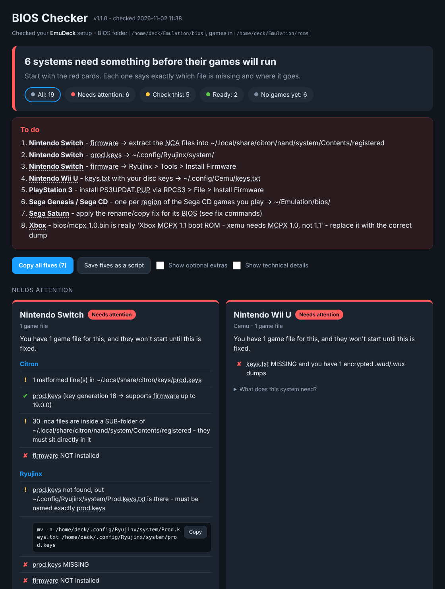

# EmuDeck BIOS Validation Script

[](https://github.com/darkuni/emudeck-bios-validation-script/actions/workflows/tests.yml)

A BIOS / firmware / keys checker for the Steam Deck that tells you what you **need**, not just "you have it or you don't".

It works with **EmuDeck** and **RetroDECK** on the Deck, **EmuDeck for Windows** on PC (PowerShell version), or any folder you point it at. On the Deck it's one plain bash script: no binaries, no Python, no network access, nothing to install. Read it top to bottom before you run it.

EmuDeck's built-in check answers true/false for 8 systems. This one hashes every file in your BIOS folder and checks it against about 510 known-good hashes and every firmware entry of every RetroArch core you have installed. Then it tells you exactly what's wrong and how to fix it.

## Quick start (friendly version)

On the Deck, in Desktop Mode, open Konsole and paste:

```bash
curl -LO https://raw.githubusercontent.com/darkuni/emudeck-bios-validation-script/main/deck-bios-check.sh
bash deck-bios-check.sh --install-shortcut
```

That puts a **BIOS Checker** icon on your desktop and in the app menu. Double-click it any time: it checks everything and opens a plain-English report in your browser.



The report:
- sorts every system into **Needs attention**, **Check this**, **Ready** and **No games yet**
- says in plain words what is wrong ("`bios_CD_U.bin` is the wrong file. It is really a Saturn BIOS.")
- explains the jargon when you hover over it (prod.keys, firmware, hash, region...)
- has a **Copy** button for every fix, plus **Copy all fixes** and **Save fixes as a script**
- explains what each system needs in a "What does this system need?" section

Remove the shortcut with `bash deck-bios-check.sh --uninstall-shortcut`.

## Windows (EmuDeck for Windows / RetroArch)

There's a native PowerShell version, `deck-bios-check.ps1`, with the same checks, the same hash database and the same friendly report. It runs on the PowerShell built into Windows 10/11 - nothing to install.

Open **PowerShell** (Start menu - type *PowerShell*) and paste:

```powershell
irm https://raw.githubusercontent.com/darkuni/emudeck-bios-validation-script/main/deck-bios-check.ps1 -OutFile deck-bios-check.ps1
powershell -ExecutionPolicy Bypass -File .\deck-bios-check.ps1 -InstallShortcut
```

That adds a **BIOS Checker** icon to your desktop and Start menu. Double-click it for the report.

Run it once without the shortcut: `powershell -ExecutionPolicy Bypass -File .\deck-bios-check.ps1 -Report`

What's different on Windows:
- Reads EmuDeck for Windows' own settings (`%APPDATA%\EmuDeck\settings.ps1`) and its emulators in `%APPDATA%\EmuDeck\Emulators`. Without EmuDeck it checks a regular RetroArch install, or any folder with `-Bios`.
- Also finds regular installs: DuckStation and PCSX2 in Documents, Ryujinx/Citron/Eden/Cemu/xemu/Vita3K in `%APPDATA%`.
- Windows-only catches: **hidden double extensions** (`scph5501.bin.bin` - Windows hides the last one), **OneDrive "online-only" files** emulators can't read, and **broken EmuDeck junctions**.
- Fixes are PowerShell commands (`Rename-Item`, `Copy-Item` that never overwrites).
- Windows doesn't care about upper/lower case, so the case check is Linux-only.

Options: `-Report`, `-ReportFile FILE`, `-NoOpen`, `-InstallShortcut`, `-UninstallShortcut`, `-Bios DIR`, `-Roms DIR`, `-All`, `-ShowOptional`, `-Unknown`, `-FixScript FILE`, `-Json FILE`, `-NoColor`, `-Help`.

## Quick start (terminal)

On the Deck, in Desktop Mode, open Konsole:

```bash
curl -LO https://raw.githubusercontent.com/darkuni/emudeck-bios-validation-script/main/deck-bios-check.sh
bash deck-bios-check.sh
```

Or make it executable once and run it directly:

```bash
chmod +x deck-bios-check.sh
./deck-bios-check.sh
```

(Forward slash. `.\deck-bios-check.sh` is Windows syntax and won't work.)

## What it catches

For every BIOS file an installed emulator or RetroArch core wants, you get one of these:

| Result | Meaning |
|---|---|
| ✔ OK | Right name, right place, hash matches a known-good dump |
| ⚠ wrong filename case | `SCPH5502.BIN` vs `scph5502.bin`. Linux is case-sensitive; Windows isn't. The #1 "but I HAVE that file" problem. |
| ⚠ right file, wrong place/name | Found by hash somewhere else in your BIOS folder. You get the exact `cp` command. |
| ✘ WRONG file | The file has the right name but it's actually something else, and it tells you what (e.g. a Saturn BIOS saved as `bios_CD_U.bin`). |
| ⚠ hash mismatch | Same system, different revision or a bad dump. Tells you what it really is. |
| ✘ missing | And whether you actually **need** it (see below). |

### "Need" is decided by your games

The script looks at your ROM folders. If `roms/segacd` has games and no usable Sega CD BIOS exists, that's a blocking **NEED**. If the folder is empty, it just tells you what you'll need later.

If you have several emulators for one system (EmuDeck installs both Beetle Saturn and Kronos, or Citron and Ryujinx), a gap in one of them isn't blocking when another one for that system is ready.

### Emulators that don't care about filenames

DuckStation and PCSX2 identify a BIOS by its contents, so any filename works. The script knows this and reports region coverage (US / EU / JP) instead. For PS2 it reads the `ROMVER` string inside the dump, so even a dump it doesn't know is identified by region, and flagged as a possible bad dump.

### The hard ones

| System | What it checks |
|---|---|
| **Switch** (yuzu, Citron, Eden, Suyu, Sudachi, Ryujinx) | `prod.keys` contents: valid `header_key` and the highest key generation, so it can tell you which firmware your keys support. Firmware NCA count; firmware extracted one folder too deep; Ryujinx firmware copied in by hand instead of installed; `Prod.keys.txt`-style naming; EmuDeck's `bios/<emu>/keys` link broken or replaced with a plain folder. |
| **PS3** (RPCS3) | Reads the installed firmware version from `dev_flash` (follows `vfs.yml`), counts system modules, checks any `PS3UPDAT.PUP` lying around has a valid header. |
| **Vita** (Vita3K) | Firmware installed, and the separate **font package**, which people forget. |
| **Xbox** (xemu) | Reads `xemu.toml`. MCPX must be **1.0** (1.1 is caught by hash), flash ROM size, HDD image is a real qcow2. |
| **Wii U** (Cemu) | `keys.txt` validity, flagged as *needed* only if you have encrypted `.wud`/`.wux` games. |
| **Neo Geo** | Opens `neogeo.zip` and checks the required files are inside, and that it sits next to your `roms/neogeo` games. |
| **GameCube** (Dolphin) | Optional IPL.bin per region, flags an IPL in the wrong region folder. |
| **DS** (melonDS) | Reads melonDS config, knows when it's using built-in FreeBIOS. |
| **Dreamcast / NAOMI / Atomiswave** | Flycast standalone and core. |
| **64DD** (RMG), **PS4** (shadPS4 modules), **3DS** (Azahar) | Covered. |
| **RetroArch** | Every installed core's firmware list, with real-world rules on top (e.g. Beetle PSX needs *one* region BIOS, not all three; the Neo Geo CD core needs a loader **and** the Y-ZOOM ROM; PUAE falls back to AROS). |

### Folder hygiene

Windows `Zone.Identifier` junk, zipped BIOS that need extracting, 0-byte files, broken symlinks, the same filename in two different cases, Switch keys dumped loose in the BIOS folder.

## Options

```
--bios DIR          check this BIOS folder (skips EmuDeck/RetroDECK detection)
--roms DIR          ROM root used to decide what you NEED (with --bios)
--frontend NAME     only check: emudeck | retrodeck
--all               also show emulators/cores you don't have installed (never blocking)
-v, --verbose       also list optional files
--unknown           list files in the BIOS folder that match nothing known
--fix-script FILE   write the suggested fix commands to FILE (never run)
--max-hash-mb N     skip hashing files bigger than N MiB (default 64)
--report            friendly HTML report, opened in your browser
--report-file FILE  write the HTML report to FILE (implies --report)
--no-open           with --report: write the file but don't open it
--install-shortcut  add a "BIOS Checker" icon (desktop + app menu)
--uninstall-shortcut  remove it again
--json FILE         machine-readable results
--no-color          plain output
--ascii             no unicode symbols
```

Exit code: `0` nothing blocking, `1` something you NEED is missing, `2` error.

## It never touches your files

The script is read-only. Fixes are printed as commands (`cp -n` / `mv -n`, which never overwrite anything). `--fix-script fixes.sh` saves them to a file you can read before you run it.

## Example

```
== Sony PlayStation - DuckStation  [23 game files in roms/psx] ==
    • DuckStation reads BIOS by hash from: ~/Emulation/bios  (filename does not matter)
    ✔ SCPH5502.BIN SCPH-5502, 5552 (v3.0 01-06-97 E) [EU]
    ✔ scph5501.bin SCPH-5501, 5503, 7003 (v3.0 11-18-96 A) [US]
    • regions covered: US ✔  EU ✔  JP -

  swanstation PlayStation  [23 game files in roms/psx]
    ✔ scph5501.bin SCPH-5501, 5503, 7003 (v3.0 11-18-96 A)
    ⚠ scph5502.bin wrong filename case: found bios/SCPH5502.BIN - Linux is case-sensitive
      ↪ mv -n /home/deck/Emulation/bios/SCPH5502.BIN /home/deck/Emulation/bios/scph5502.bin

  genesis_plus_gx Sega 8/16-bit (Various)
    ✘ bios_CD_U.bin is the WRONG file - it is actually: Saturn sega_101 (JP v1.01)
    ✘ MISSING - one per region of the Sega CD games you play [4 game files in roms/segacd]
      any of: bios_CD_E.bin, bios_CD_U.bin, bios_CD_J.bin

== Nintendo Switch  [12 game files in roms/switch] ==
  Citron keys: ~/.local/share/citron/keys  firmware: ~/.local/share/citron/nand/system/Contents/registered
    ✔ prod.keys (key generation 18 -> supports firmware up to 19.0.0)
    ⚠ 30 .nca files are inside a SUB-folder of .../registered - they must sit directly in it
    ✘ firmware NOT installed

== SUMMARY ==
  YOU NEED (blocking - you have games for these):
    ✘ Sega CD (genesis_plus_gx_libretro): one per region of the Sega CD games you play -> ~/Emulation/bios/
    ✘ Switch (Citron): firmware -> extract the NCA files into ~/.local/share/citron/nand/system/Contents/registered
```

## Known limits

- **Switch firmware version** can't be read without decrypting the firmware files. The script reports the newest firmware your keys support and checks that the firmware looks complete.
- **Xbox flash ROM** is checked by size only (no reliable reference hash).
- **MAME / FBNeo zip hashes** change between versions, so zips are tested for integrity rather than matched by hash. `neogeo.zip` is also checked file by file.
- Some dumps are unique to each console (DS `firmware.bin`, DSi NAND), so those are checked for presence and size only.

## No BIOS files here

This repo contains **hashes only**, never BIOS, firmware or keys. Dump your own from hardware you own.

## Data sources

The hash database is generated from, and credit goes to:

- [libretro-database](https://github.com/libretro/libretro-database) `System.dat` and [libretro-core-info](https://github.com/libretro/libretro-core-info) firmware tables
- [DuckStation](https://github.com/stenzek/duckstation)'s PS1/PS2 BIOS table (`src/core/bios.cpp`)
- [EmuDeck](https://github.com/dragoonDorise/EmuDeck) `checkBIOS.sh` hash lists, emulator path setup and wiki cheat sheets
- [RetroDECK components](https://github.com/RetroDECK/components) BIOS manifests

## For contributors

The script is built from a template plus generated data:

```
tools/template.sh       Linux/Deck script logic (edit this, not deck-bios-check.sh)
tools/template.ps1      Windows PowerShell script logic (edit this, not deck-bios-check.ps1)
tools/report.html       the friendly report page, shared by both (inlined at build time)
tools/data/rules.txt    real-world "what do you actually need" rules, shared by both
tools/VERSION           version stamped into both scripts
tools/data/known.txt    md5|TAG|REGION|description
tools/data/ra.txt       RetroArch core firmware table
tools/update-data.sh    re-pull all upstream sources and rebuild (needs git, jq, python3)
tools/build.sh          rebuild both scripts from templates + data
tests/run-mock.sh       builds a fake Deck full of mistakes and checks each one is caught
tests/run-mock.ps1      same for a fake EmuDeck-for-Windows install
```

Neither test needs real BIOS files. They swap reference hashes for the hashes of dummy files. GitHub Actions runs them on every push: bash on Linux, Windows PowerShell 5.1 and PowerShell 7 on Windows, and PowerShell 7 on Linux.

Bug reports with your output (`--no-color`) and `grep Path= ~/.config/EmuDeck/settings.sh` are welcome.

## License

MIT, by darkuni (MonroeWorld).
